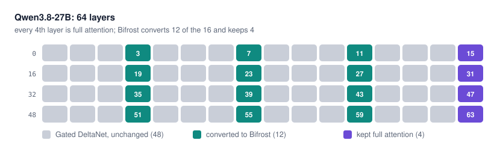
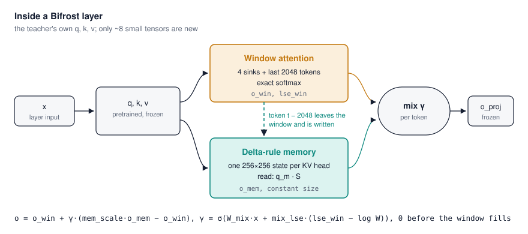
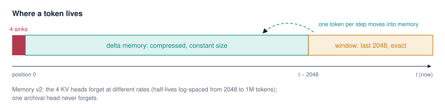
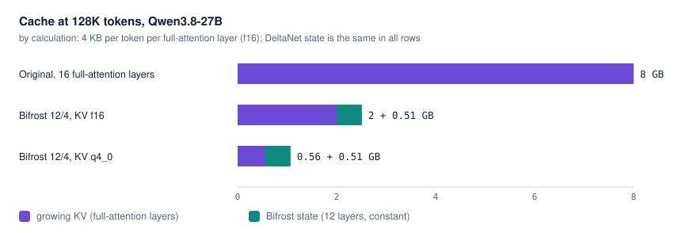
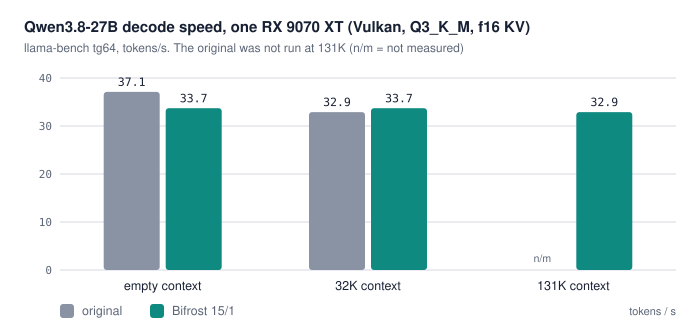
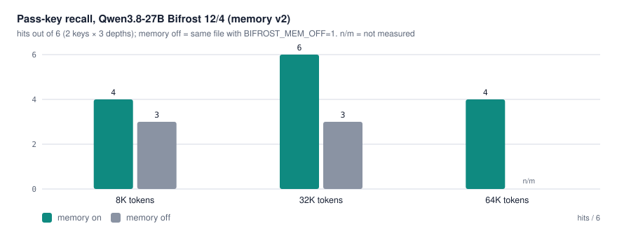
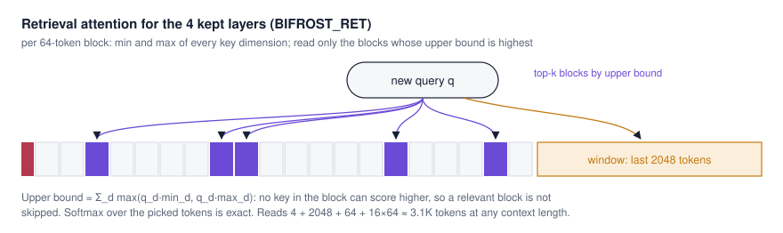
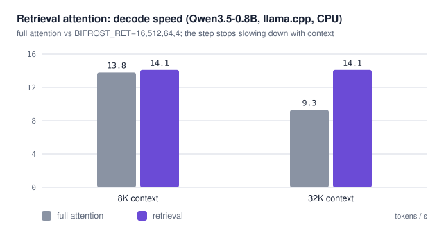
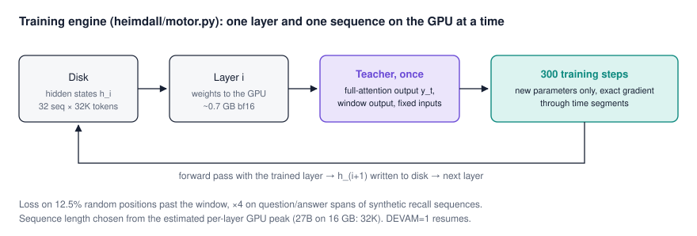
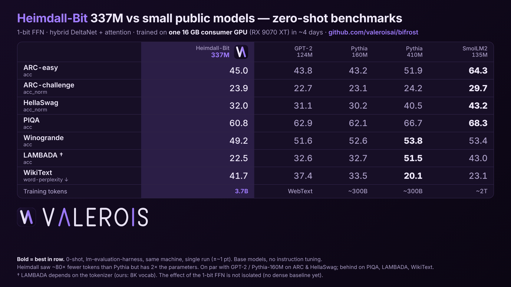

<p><picture><source media="(prefers-color-scheme: dark)" srcset="docs/brand/valerois-wordmark-on-dark-2400.png"></picture></p>

# Bifrost & Heimdall

**Long-context language models that fit on one consumer GPU.** Bifrost converts a pretrained model's growing attention layers into constant-memory layers; Heimdall is the research codebase around it (hybrid architecture, 1-bit training, kernels, a llama.cpp port and an OpenAI-compatible server).

[](LICENSE)


| | Qwen3.8-27B, original | Qwen3.8-27B, Bifrost 12/4 |
|---|---|---|
| Cache at 128K tokens (f16 KV, by calculation) | 8.0 GB | **2.5 GB** (1.1 GB with q4_0 KV) |
| Decode speed, 32K filled context (q8_0 KV) | 33.7 t/s | **33.7 t/s** |
| Prefill speed, 32K filled context (q8_0 KV) | 595 t/s | **788 t/s** |
| WikiText-2 perplexity (8K context) | 5.98 | 6.15 (+2.9 %) |
| Pass-key recall, 32K | 6/6 | 6/6 |

*One RX 9070 XT (16 GB), Vulkan, Q3_K_M weights, llama.cpp with our patch. Small samples; details and the failures in [Bifrost on Qwen3.8-27B](#bifrost-on-qwen38-27b).*

- [How Bifrost works](#how-bifrost-works)
- [Bifrost on Qwen3.8-27B](#bifrost-on-qwen38-27b) · [Retrieval attention](#retrieval-attention-for-the-kept-layers) · [Training engine](#the-training-engine)
- [Heimdall-Bit: training from scratch with 1-bit feed-forward layers](#heimdall-bit-training-from-scratch-with-1-bit-feed-forward-layers)
- [Limitations](#limitations) · [Quick start](#quick-start) · [Repository layout](#repository-layout) · [License](#license)

All numbers were measured on one workstation: **AMD Radeon RX 9070 XT (16 GB, gfx1201) + Ryzen 7 7800X3D**, ROCm 10.1 / PyTorch 2.14 for training, llama.cpp (Vulkan, RADV) for inference. Comparisons are single runs unless stated otherwise.

---

## How Bifrost works

Qwen3.8-27B is already three-quarters constant-memory: 48 of its 64 layers are Gated DeltaNet, which compresses the past into a fixed-size state. Every fourth layer is full attention, which stores a key and a value for every token, so those 16 layers are what grows with context. Bifrost converts 12 of them and keeps 4 (layers 15, 31, 47, 63) as exact full attention.

<p align="center"></p>

A converted layer reuses the original `q`, `k`, `v` and output projections unchanged (frozen) and splits attention into two branches: exact attention over a 2048-token window plus 4 sink tokens, and a delta-rule memory with one 256×256 state per KV head. A token is written into memory at the moment it leaves the window, so the two branches never count the same token twice. A learned gate γ mixes them per token, using the window's own log-sum-exp as a "did the window find anything?" signal. Inside the window the layer is identical to the original.

<p align="center"></p>

<p align="center"></p>

Only about 8 small tensors per layer are trained (`fq, fk, ab, mix, mix_lse, mem_scale, A_log, dt_bias`); none of the pretrained weights change. In memory v2 the four KV heads forget at different rates, with half-lives log-spaced from 2048 to 1M tokens and one archival head that never forgets.

<p align="center"></p>

## Bifrost on Qwen3.8-27B

Converted on the same single GPU. Inference runs in llama.cpp's own `qwen35` architecture: converted layers become recurrent layers with a constant state ([`Heimdall/llamacpp/`](Heimdall/llamacpp/README.md), a 16-file patch with Vulkan and CUDA/HIP kernels for head dimension 256).

**Speed** (llama-bench, tokens/s, Q3_K_M weights):

<p align="center"></p>

| Model | KV cache | decode, empty | decode, 32K | prefill, 32K |
|---|---|---|---|---|
| Original | f16 | 37.1 | 32.9 | 682 |
| Bifrost 15/1 (one layer kept) | f16 | 33.7 | 33.7 (131K: 32.9) | **832** |
| Original | q8_0 | 36.8 | 33.7 | 595 |
| Bifrost 12/4 | q8_0 | 34.3 | 33.7 | **788** |
| Original | q4_0 | 36.7 | 34.2 | 594 |
| Bifrost 12/4 | q4_0 | 34.2 | 33.8 | **754** |

Bifrost is 7–9 % slower at short context, where the extra small ops of the converted layers cost ~2.7 ms per token (a fused decode kernel would remove most of this). From 32K on it decodes as fast as the original and prefills 22–32 % faster, and its speed barely changes up to 131K.

**Quality** (WikiText-2 test, `llama-perplexity`, 8K context, 8 chunks; ±0.08):

| Original | Bifrost 15/1 | Bifrost 12/4 | 12/4, q4_0 KV | 12/4, memory v2 |
|---|---|---|---|---|
| 5.976 | 6.175 | 6.154 | 6.154 | **6.150** |

**Pass-key retrieval** (a 5-digit key hidden in filler text, 3 depths × 2 keys per length, greedy, the model may answer after thinking):

<p align="center"></p>

| | 8K | 32K | 64K | total |
|---|---|---|---|---|
| Bifrost 12/4, memory v2 | 4/6 | **6/6** | 4/6 | **14/18** |
| same file, memory off (`BIFROST_MEM_OFF=1`) | 3/6 | 3/6 | not measured | |
| first conversion (memory v1), 3 depths × 1 key | 1/3 | 2/3 | 0/3 | 3/9 |
| original model, same 9 keys as v1 | 3/3 | 3/3 | 3/3 | 9/9 |

The memory matters: turning it off on the same file halves the hits at 32K. The misses at 64K are keys placed early (depth 0.1, ~60K tokens back), where the model answers with the first digit only. The original model is still better at exact far recall. These are small samples on a synthetic test, not a benchmark.

### Retrieval attention for the kept layers

The 4 kept layers stay exact, but reading their whole KV cache every step slows decoding as the context grows. With `BIFROST_RET=k,window,block,sinks` each kept layer keeps the min and max of every key dimension per 64-token block, computes from them an upper bound on q·k for every block, and reads only the sinks, the window and the top-k blocks per KV head. The softmax over the picked tokens is exact; no training is needed and it works on unconverted models too.

<p align="center"></p>

| Check (Qwen3.5-0.8B, 6 full-attention layers) | Result |
|---|---|
| Pass-key, 8K and 16K, 3 depths (PyTorch) | full attention 6/6 · window 512 only 0/6 · **window 512 + 16 blocks 6/6** |
| same, prompt also read with retrieval | 6/6 |
| llama.cpp vs PyTorch reference, 352 decode steps | same top token at every step, max logit difference 9e-4 (retrieval itself moves logits by 5e-2) |
| Decode speed, CPU, llama.cpp | 8K: 13.8 → 14.1 t/s · **32K: 9.3 → 14.1 t/s** |

<p align="center"></p>

Not yet measured on the 27B or on a GPU. In llama.cpp the prompt is still read with full attention, it needs flash attention and one sequence, and the KV cache still lives on the GPU (moving it to host RAM is the next step).

### The training engine

`heimdall/motor.py` trains one layer at a time with one sequence on the GPU: hidden states for all calibration sequences live on disk, the teacher's attention output is computed once per sequence (blockwise, so 32K–64K sequences fit), and only the new parameters are trained, with an exact gradient through time segments. It picks the sequence length from an estimate of the per-layer GPU peak and resumes where it stopped (`DEVAM=1`).

<p align="center"></p>

On Qwen3.5-0.8B (16K sequences, 300 steps per layer, 40 minutes, 2.7 GB peak) the last converted layer's validation error relative to the teacher went from 0.082 (window only) to **0.033**. A 27B run with 32K sequences is in progress.

<details><summary>First small-scale test (SmolLM2-135M, before the Qwen work)</summary>

SmolLM2-135M (30 layers), sliding window 64 + 4 attention-sink tokens + delta-rule memory, **0.8 M training tokens (~4 min on the GPU)**, WikiText perplexity at 2 K context:

| | Perplexity |
|---|---|
| Original (full attention) | 14.09 |
| Window only (no memory) | 25.76 |
| Converted, untrained | 26.70 |
| After layer-wise attention transfer | 22.43 |
| **After end-to-end distillation** | **17.61** |

About 70 % of the gap between "window only" and the original is closed with 0.8 M tokens, while the cache stays at 5.7 MB regardless of context length (the original needs 180 MB at 8 K tokens and ~22 GB at 1 M). It is **not** at parity (+25 % perplexity) and long-context retrieval quality has not been established. Our reimplementation of the teacher matches the Hugging Face `transformers` logits exactly (checked on SmolLM2-135M and Qwen3-0.6B). 4-bit teacher weights (`--q4`) cost +7 % perplexity on Qwen3-0.6B at 318 MB.

</details>

---

## Heimdall-Bit: training from scratch with 1-bit feed-forward layers



*0-shot, lm-evaluation-harness, same machine, single run (±~1 point). Details in [B7](#b7-standard-benchmarks-zero-shot-against-small-public-models-same-harness-same-machine).*

A from-scratch research line in the same codebase:

1. **A hybrid architecture**: 3 Gated DeltaNet layers (fixed-size recurrent memory) for every 1 global-attention layer, so the inference cache is ~12× smaller than a same-size Transformer's (by calculation).
2. **A latent-free 1-bit / 1.58-bit training engine**: binary (±1) or ternary weights are the *only* copy of the weights (no fp32 shadow weights, no Adam state); a custom optimizer (`BitFlip`) flips the strongest-gradient weights directly.
3. **Triton kernels** for int8 and packed 1/2-bit matrix products, and an **OpenAI-compatible inference server** (continuous batching, API keys, rate limits, Prometheus metrics; unit-tested, not load-tested).


The design study (B3) and the first small-scale comparison ran on ROCm 6.4 / PyTorch 2.9.1 in eager mode; later results on ROCm 10.1 / PyTorch 2.14. Differences of ~0.03 nats or less should be treated as noise.

### B1. Training throughput on one 16 GB consumer GPU
| Model | Tokens | Speed | Memory | Wall-clock |
|---|---|---|---|---|
| Heimdall-Bit, 98 M params (binary FFN, `--arch bit --bits 1`) | 800 M | **47.4 K tok/s** (stable for the whole run) | 13.3 GB | 4.7 h, no crash |
| Heimdall-Bit, 337 M params (`--preset buyuk --arch bit --bits 1`) | 3.70 B | **~11.2 K tok/s** (~24 TFLOPS) | 11.3 GB | ~92 h of training, paused/resumed several times from checkpoints |

`torch.compile` on the ROCm 10.1 / PyTorch 2.14 stack gave **2.9× faster training and 2.4× lower memory** than eager mode on a 5.8 M model (90 K → 264 K tok/s, 3.1 → 1.3 GB) with unchanged validation loss.

### B2. Latent-free low-bit training works, but its advantage fades with scale
Question tested: *can a model whose FFN weights are 1-bit match a dense model with half as many parameters?* (equal data, validation loss in nats/token, lower is better)

| Scale (bit model vs dense half-size) | Dense, N/2 params | Bit model, N params |
|---|---|---|
| 6 M vs 3 M (2 seeds) | 2.056 / 1.937 | **1.842 / 1.764** (ternary FFN), **1.840 / 1.752** (binary FFN) |
| 46 M vs 23 M (20 M tokens) | 1.646 / 1.635 | 1.651 / 1.656 |
| 98 M vs 52 M (40 M tokens) | **1.309** | 1.330 |

At small scale the bit model is clearly ahead; at ~50 M it ties; at ~100 M it is slightly behind (+0.02 nats). **We do not claim the target is met at scale.** Whether the gap closes with more data and larger models is the main open question (see *Proposed next steps*). Binary (±1) FFN weights were as good as ternary ones in these tests.

### B3. Design study: where to put the bits (6 M scale, 10 M tokens)
| Variant | Params | Val loss | vs dense |
|---|---|---|---|
| Dense | 5.8 M | 1.785 | — |
| All matrices ternary | 5.8 M | 2.093 | +0.308 |
| All matrices binary | 5.8 M | 2.128 | +0.343 |
| All ternary, 25 % wider | 8.0 M | 1.994 | +0.209 |
| All ternary + rank-16 dense corrector | 6.3 M | 1.997 | +0.212 |
| FFN-only ternary | 5.8 M | 1.916 | +0.131 |
| **FFN ternary + rank-16 corrector** (`--arch bit`) | 6.1 M | **1.842** | **+0.057** |

Most of the quality loss comes from binarizing the attention/DeltaNet projections; keeping those dense and adding a small dense low-rank corrector next to each bit matrix recovers most of it. In the final design **58 % of parameters are 1-bit** (FFN); the rest (mixers, embeddings) stay dense.

### B4. Kernels (layer-level micro-benchmarks, RX 9070 XT, ROCm 10.1)
Single-token decoding (M=1, 4096×4096): bf16 0.228 ms → **int8 Triton 0.081 ms (2.8×)**, packed 1-bit 0.090 ms (2.5×), packed 2-bit 0.083 ms (2.7×); relative error 0.8 % (int8) / 0.17 % (packed). For prefill/training shapes our kernels are *slower* than bf16 (0.33–0.72×), so training uses plain bf16. These are layer benchmarks, not end-to-end generation speed.

### B5. Toy recall task (MQAR, ~100 K params, 8 CPU-minutes, single seed)
Train gap ≤ 64 tokens, tested up to 16 K: attention-only 15.6 → 0.8 %, pure DeltaNet ~14.8 %, **hybrid 99.9 → 100 %**. Small and noisy, but consistent with the design rationale.

### B6. The 337 M run (3.7 B tokens): final losses, context behaviour, comparison with the legacy model
Mixture: FineWeb-Edu 55 %, Cosmopedia 21 %, GitHub code 25 % (1.1 B code tokens). One run, one seed, WSD schedule (last 25 % of steps decays the learning rate to 0). Final validation loss, nats/token with the 8 K-vocabulary tokenizer (**not comparable to public models' perplexities**):

| FineWeb-Edu | FineWeb-Edu (2nd split) | GitHub code | GitHub code (2nd split) | Cosmopedia |
|---|---|---|---|---|
| 2.707 (ppl 15.0) | 2.668 (ppl 14.4) | 0.743 (ppl 2.1) | 0.606 (ppl 1.8) | 1.773 (ppl 5.9) |

The code losses are optimistic (boilerplate and near-duplicates in GitHub code). Samples: fluent English and plausible Python structure, but wrong facts and wrong logic, and greedy decoding loops (it is a base model: no instruction tuning).

**Beyond the training length (trained at 2 048 tokens; checkpoint, held-out GitHub code, 8 windows × 8 192 tokens):**

| Position | 512–1024 | 1024–2048 | 2048–4096 | 4096–8192 |
|---|---|---|---|---|
| Loss (nats) | 0.658 | 0.592 | **0.546** | 0.817 |

Loss keeps falling past the training length up to ~4 K, then rises (1.38× the 1024–2048 value). Passkey retrieval (a 5-digit number planted in repetitive filler text; 15 trials per length): **100 % at 512, 1 K, 2 K and 4 K tokens, 80 % at 8 K** (the far-placed key fails: 2/5; middle and near: 5/5). Measured cache: 18.7 MB (512 tokens) → 109 MB (8 192 tokens), growing ~11.8 KB per token because only the global-attention layers grow; the DeltaNet layers are constant. These are small samples on an easy test (`bench/baglam.py`).

**Versus the legacy Valkir 16L model (116 M params, constant-dilation CSL)**, same tokenizer, 200 held-out windows × 512 tokens from a GitHub code shard neither model trained on:

| | all positions | positions 256–512 |
|---|---|---|
| Valkir 16L | 3.226 nats (ppl 25.2) | 3.249 |
| Heimdall 337 M | 1.011 nats (ppl 2.75) | 0.874 |

Read this carefully: Heimdall has 2.9× the parameters, and Valkir was trained mostly by repeating a small corpus (25.6 M tokens, ~185 passes, per our legacy notes) — on that corpus it reaches 0.72 nats, so it generalizes poorly. This shows the new model is far better than the old one on unseen code; it is **not** an equal-size/equal-data comparison of architectures. We have not trained a dense Transformer baseline at this scale.

### B7. Standard benchmarks, zero-shot, against small public models (same harness, same machine)
`lm-evaluation-harness`, 0-shot, full test sets, one run (standard error ≈ ±1 point; ±1.4 on Winogrande). Heimdall was evaluated with our adapter (`bench/lmeval_heimdall.py`, 2 048-token windows); the public models through the harness's HF backend (GPT-2: 1 024-token windows, Pythia and SmolLM2: 2 048). Higher is better except perplexities.

| | **Heimdall-Bit 337 M** | GPT-2 (124 M) | Pythia-160 M | Pythia-410 M | SmolLM2-135 M | chance |
|---|---|---|---|---|---|---|
| Training tokens | **3.7 B** | WebText (~40 GB text; token count not stated) | ~300 B | ~300 B | ~2 T | |
| ARC-easy (acc) | 45.0 | 43.8 | 43.2 | 51.9 | 64.3 | 25 |
| ARC-challenge (acc_norm) | 23.9 | 22.7 | 23.1 | 24.2 | 29.7 | 25 |
| HellaSwag (acc_norm) | 32.0 | 31.1 | 30.2 | 40.5 | 43.2 | 25 |
| PIQA (acc) | 60.8 | 62.9 | 62.1 | 66.7 | 68.3 | 50 |
| Winogrande (acc) | 49.2 | 51.6 | 52.6 | 53.8 | 53.4 | 50 |
| LAMBADA (acc) / ppl† | 22.5 / 84.8 | 32.6 / 40.1 | 32.7 / 38.2 | 51.5 / 10.8 | 43.0 / 19.1 | |
| WikiText word-perplexity ↓ | 41.7 | 37.4 | 33.5 | 20.1 | 23.1 | |

Reading: with 1/80 of Pythia's training tokens, Heimdall is in the same range as GPT-2-small and Pythia-160 M on ARC-easy, ARC-challenge (all at chance) and HellaSwag (differences within ~1 point), is **behind** on PIQA (−1 to −2), Winogrande (at chance), LAMBADA and WikiText (41.7 vs 33–37), and **clearly behind** Pythia-410 M and SmolLM2-135 M. It has more than twice the parameters of the models it matches, and we cannot attribute any of this to the 1-bit FFN (no dense baseline). †LAMBADA accuracy and perplexity depend on the tokenizer (our 8 K vocabulary splits words into more tokens) and are not comparable across models; WikiText *word*-perplexity is. Our mixture also spends 25 % of tokens on code, which these text benchmarks do not reward.

---

## Limitations

**Bifrost**
- Exact recall far back (~60K tokens) is still worse than the original; pass-key tests are small samples on one synthetic task. No RULER-style or downstream long-context benchmark yet.
- Perplexity is 2.9 % above the original at 8K context; quality on chat and reasoning tasks has not been measured.
- 7–9 % slower than the original at short context until the converted layer has a fused decode kernel.
- Converted only one model family so far (Qwen3.5 / 3.8 dense, 0.8B and 27B). MTP speculative decoding with Bifrost layers is not implemented.
- Retrieval attention: measured on 0.8B only; prompt still uses full attention in llama.cpp; KV still on the GPU.

**Heimdall-Bit**
- **Scale:** the largest model trained from scratch is 337 M parameters on 3.7 B tokens (below the ~20 tokens/parameter heuristic). Outputs are fluent but factually wrong and loop under greedy decoding. We have no dense/Transformer baseline at this scale, so the effect of the 1-bit FFN and of the hybrid layout on the scores is unknown.
- The 1-bit advantage over a half-size dense model **does not persist** at ~100 M parameters in our tests.
- Training memory is not 1-bit: bit weights cost ~6 bytes/parameter during training (weight + gradient + momentum, all bf16) versus ~16–18 for AdamW with fp32 master weights. Only the FFN (58 % of parameters) is 1-bit.
- Multi-GPU training and a production deployment record are not implemented. Docker images are provided but not built in CI.

Code comments, CLI flag names and some log messages are in Turkish (glossary in [`Heimdall/README.md`](Heimdall/README.md)).

## Quick start

```bash
git clone https://github.com/valeroisai/heimdall.git && cd heimdall/Heimdall
python3 -m venv .venv && source .venv/bin/activate
# AMD RX 9070 XT / ROCm 10.1 (the configuration we measured):
pip install --index-url https://stable.repo.amd.com/rocm/whl-next/ "torch[device-gfx1201]==2.14.0+rocm10.1.0"
# NVIDIA: pip install torch --index-url https://download.pytorch.org/whl/cu128   (device-agnostic code; CUDA not benchmarked by us)
pip install numpy tokenizers safetensors fastapi "uvicorn[standard]" pydantic huggingface_hub pyarrow httpx pytest
python -m pytest -q tests        # CPU unit tests
```

**Bifrost**, end to end (steps of [`bench/qwen38_donustur.sh`](Heimdall/bench/qwen38_donustur.sh)):

```bash
GPU=vulkan bash llamacpp/kur.sh                    # llama.cpp at the pinned commit + bifrost.patch (or GPU=hip / cpu)
ADIM=motorprova bash bench/qwen38_donustur.sh      # 0.8B: train with the engine, GGUF, pass-key, perplexity (~1 h)
ADIM=motor      bash bench/qwen38_donustur.sh      # 27B: 12/4 conversion with the engine (several hours on 16 GB)
ADIM=motortest  bash bench/qwen38_donustur.sh      # 27B: GGUF + pass-key (memory on/off) + perplexity + speed
ADIM=erisim     bash bench/qwen38_donustur.sh      # retrieval attention off vs on
ADIM=sunucu     bash bench/qwen38_donustur.sh      # OpenAI-compatible server on http://127.0.0.1:1234/v1
```

**Heimdall-Bit:**

```bash
python -m heimdall.train --preset temel --arch bit --bits 1 --data ../stream_coder_100k.bin --tokens 40e6 --out runs/demo
bash bench/hedef.sh orta        # reproduces the bit-vs-half-size-dense comparison (46 M vs 23 M)
```

See [`Heimdall/README.md`](Heimdall/README.md) for the architecture, every benchmark script and the serving API. The figures in this README are generated from the measured numbers by [`docs/figures.py`](docs/figures.py).

## Repository layout

| Path | Content |
|---|---|
| [`Heimdall/heimdall/`](Heimdall/heimdall) | Models (`hibrit.py`: Qwen3.5/3.8 teacher and Bifrost layers), training engine (`motor.py`), 1-bit engine, kernels, server |
| [`Heimdall/llamacpp/`](Heimdall/llamacpp/README.md) | llama.cpp patch (Bifrost layers, retrieval attention), GGUF converter, test tools |
| [`Heimdall/bench/`](Heimdall/bench) | Reproducible run scripts and benchmarks |
| [`Heimdall/runtime/`](Heimdall/runtime) | Valerois Runtime: one-command local server for Windows and Linux |
| [`Heimdall/tests/`](Heimdall/tests) | Unit tests (CPU) |
| [`docs/`](docs) | Figures (`figures.py` → `img/`), architecture diagram, brand assets |
| `04_TOKENIZERLAR/` | Tokenizers for the from-scratch models (default `valerois_tokenizer_8k.json`, vocab 8192) |
| `stream_coder_100k.bin` | 25.6 M-token code corpus (uint16) used in the small-scale studies |
| [`OLD/`](OLD) | Archive of earlier research (Bifrost CSL, Kuzgun, Valkir, Kuyu); superseded, kept for history |

## License

Apache License 2.0, see [`LICENSE`](LICENSE) and [`NOTICE`](NOTICE). The llama.cpp patch is distributed under llama.cpp's MIT license. Models converted with Bifrost keep the license of their base model (Qwen3.5 / 3.8: Apache-2.0).

## Citation

```bibtex
@software{valerois_bifrost_2026,
  author = {{Valerois AI}},
  title  = {Bifrost and Heimdall: constant-memory conversion of pretrained language models on a single GPU},
  year   = {2026},
  url    = {https://github.com/valeroisai/heimdall}
}
```
